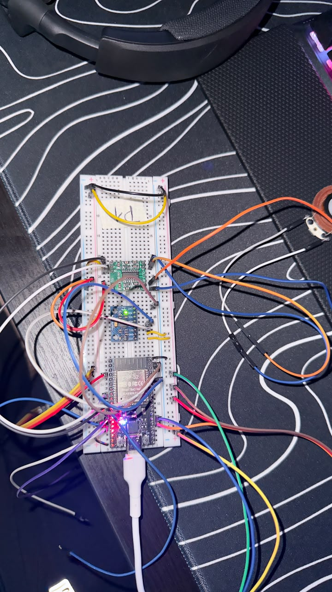
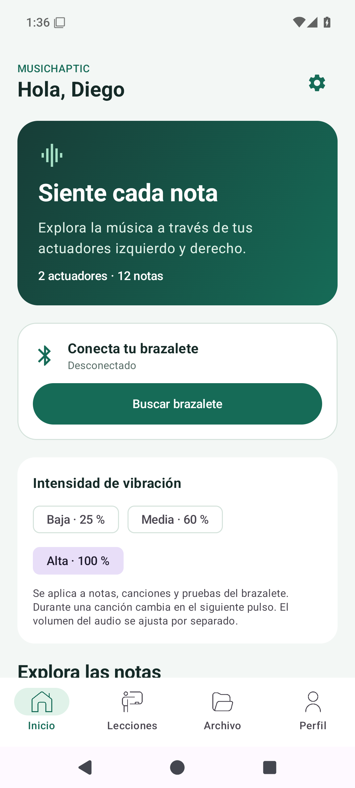
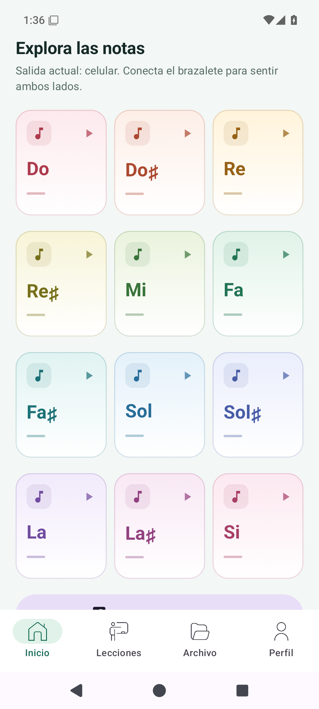
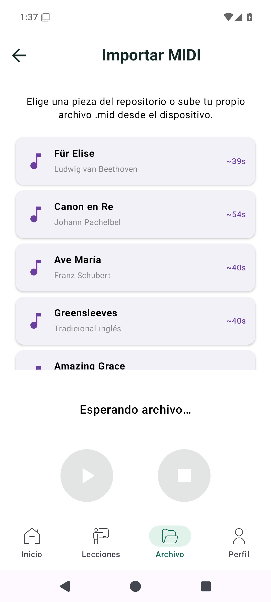
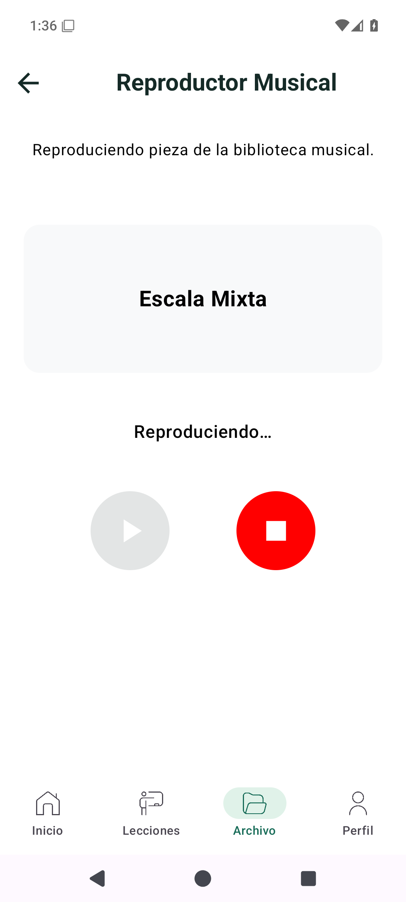
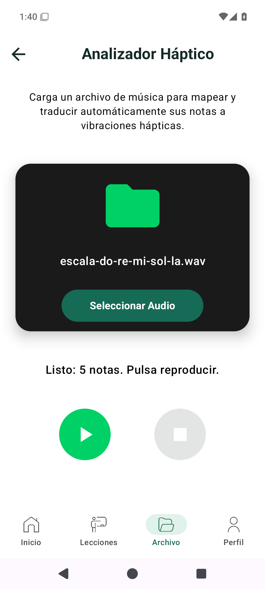
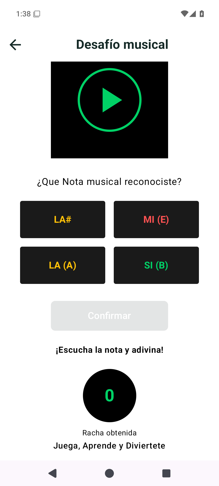
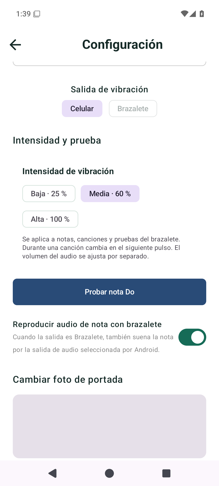
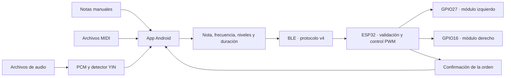

# Sintiendo la música

**MusicHaptic + ESP32: representación de notas musicales mediante vibraciones.**

[](https://github.com/dsgsix/musichaptic-esp32/actions/workflows/verify.yml)

Prototipo de accesibilidad musical que conecta una aplicación Android con un brazalete de dos módulos vibrotáctiles. La app convierte notas y secuencias en órdenes Bluetooth Low Energy; el ESP32 controla la frecuencia eléctrica, la duración y el reparto de intensidad entre el lado izquierdo y el derecho.

El proyecto reúne desarrollo móvil, procesamiento de señales y programación de sistemas embebidos. Su propósito es explorar otra forma de acceder a la información musical, con especial interés en las personas sordas.

<table>
  <tr>
    <td align="center"><br><sub>Prototipo de actuación dual</sub></td>
    <td align="center"><br><sub>Aplicación Android MusicHaptic</sub></td>
  </tr>
</table>

[Aplicación en funcionamiento](docs/EVIDENCIAS.md) · [Montaje](#montaje) · [Validación técnica](docs/VALIDACION.md) · [Informe del proyecto](docs/informe-sintiendo-la-musica.pdf)

## Funciones

- Exploración de notas y ejercicios de aprendizaje desde la app.
- Catálogo musical, importación MIDI y análisis de archivos de audio con detección de tono YIN.
- Reparto espacial de doce notas: DO hacia la izquierda, SI hacia la derecha y combinaciones intermedias.
- Intensidad seleccionable: baja (25 %), media (60 %) y alta (100 %).
- Tonos musicales de referencia en el teléfono, separados de la señal háptica.
- Comunicación BLE con validación de tramas, confirmaciones y parada de las salidas.
- Diagnóstico y configuración por USB mediante comandos del monitor serial.
- Perfiles, progreso y secuencias guardados localmente en SQLite.

## La aplicación en funcionamiento

<table>
  <tr>
    <th>Exploración de notas</th>
    <th>Catálogo MIDI</th>
    <th>Reproducción de secuencias</th>
  </tr>
  <tr>
    <td></td>
    <td></td>
    <td></td>
  </tr>
  <tr>
    <th>Análisis de audio</th>
    <th>Desafío musical</th>
    <th>Intensidad y salida</th>
  </tr>
  <tr>
    <td></td>
    <td></td>
    <td></td>
  </tr>
</table>

Capturas de la aplicación ejecutándose en un emulador Android 15, con datos de demostración y el modo de salida Celular. La [galería de evidencias](docs/EVIDENCIAS.md) detalla las pantallas, el entorno y el recorrido de uso.

## Cómo funciona



La escala háptica utiliza doce frecuencias de referencia entre **62,15 y 553,83 Hz**. Es distinta de la afinación del audio del teléfono. En modo `FREQ`, ambos canales comparten la frecuencia del temporizador y tienen niveles independientes; el duty máximo inicial es 75 %, configurable mediante `FREQDUTY` entre 50 y 90 %. En modo `POWER`, se usa PWM fijo a 1 kHz.

Cuando hay notas superpuestas con frecuencias diferentes, la reproducción selecciona una frecuencia por segmento. El sistema no reproduce acordes mecánicos independientes en ambos canales.

## Tecnologías

| Componente | Herramientas |
|---|---|
| App Android 2.5.0 | Kotlin, Java, Jetpack Compose, coroutines, SQLite, BLE GATT |
| Análisis de audio activo | Decodificación PCM y detector YIN en Kotlin/Java |
| Firmware Vibrafil Dual 5.1 | C++, Arduino para ESP32, PlatformIO, LEDC/PWM |
| Construcción Android | Gradle 8.11.1, AGP 8.9.2, Kotlin 2.1.20, JDK 17, SDK 35 |
| Pruebas | Suites C++, Java y pruebas de interoperabilidad app–firmware |

## Estructura

```text
android/     Proyecto de Android Studio, recursos y pruebas
firmware/    Proyecto de PlatformIO para ESP32 y pruebas
docs/        Documentación técnica y evidencias del prototipo
```

## Montaje

| Conexión del ESP32 | Destino |
|---|---|
| GPIO27 | Entrada de control del módulo izquierdo |
| GPIO16 | Entrada de control del módulo derecho |
| GND | Referencia común con los módulos |
| USB | Programación y monitor serial a 115200 baudios |

Los GPIO controlan módulos con driver y entrada de señal compatible con 3,3 V. **No se conecta una bobina o un actuador de dos cables directamente a un GPIO.** La alimentación y las conexiones de potencia deben corresponder a la ficha técnica del módulo utilizado.

Esta versión no utiliza micrófono MAX4466, MPU6050, DAC ni voicecoil central.

## Instalación

```bash
git clone https://github.com/dsgsix/musichaptic-esp32.git
cd musichaptic-esp32
```

### Firmware

Abre `firmware/` en VS Code con PlatformIO. Compila y carga el entorno `esp32_brazalete`; después abre el monitor serial. Desde una terminal con PlatformIO disponible:

```bash
cd firmware
pio run -e esp32_brazalete
pio run -e esp32_brazalete -t upload
pio device monitor
```

Prueba estos comandos dentro del monitor serial, uno por línea:

```text
STATUS
PLAY DO
LAST
PLAY SI
LAST
STOP
```

Consulta [la guía del firmware](firmware/LEEME_PRIMERO.md) para ajustar ganancia, duty, modo y pruebas de cada lado.

### Aplicación Android

1. Abre `android/` en Android Studio.
2. Configura **JDK 17**, **Android SDK Platform 35** y **Build Tools 35.0.0**.
3. Sincroniza Gradle y ejecuta la app en un teléfono con **Android 7.0 o superior**.
4. Con el firmware cargado, concede los permisos Bluetooth solicitados y conecta **ESP32 Vibrafil**.
5. Explora una nota, selecciona la intensidad y comprueba ambos módulos.

Para compilar desde `android/` en Windows:

```powershell
.\gradlew.bat testDebugUnitTest assembleDebug
```

En Linux/macOS se utiliza `./gradlew`. Las cuentas, pistas y progreso son locales. Para conservar una instalación anterior se necesita la misma firma de la aplicación. Más detalles en [la guía Android](android/LEEME_PRIMERO.md).

## Pruebas

Desde la raíz, con Python 3, un JDK completo y `g++` disponibles:

```bash
python firmware/tests/run_tests.py
python android/tests/run_core_tests.py firmware/include
```

La segunda orden comprueba también el intercambio de tramas y confirmaciones con el protocolo del firmware. Las pruebas de núcleo se ejecutan sin teléfono ni ESP32. Los resultados, el entorno y la cobertura están en [Validación técnica](docs/VALIDACION.md).

## Alcance y limitaciones

La frecuencia configurada en un GPIO describe la señal eléctrica, no una medición de vibración mecánica. La respuesta depende del actuador, el driver y el contacto con el brazo. Quedan pendientes la caracterización física y la evaluación de comprensión y comodidad con las personas destinatarias.

El análisis de audio está orientado a melodías con un tono predominante; no es una transcripción polifónica completa. El archivo Python incluido es una referencia de una etapa anterior y no está integrado en la ejecución Android actual. El JSON de notas conserva metadatos de un montaje previo; el hardware vigente se define en el firmware.

La gestión local de usuarios pertenece al prototipo: las contraseñas se guardan en SQLite sin hash y una migración de versión de la base puede recrear las tablas. Utiliza datos de demostración.

## Documentación

- [Galería de evidencias: montaje y aplicación](docs/EVIDENCIAS.md).
- [Informe de Sintiendo la música](docs/informe-sintiendo-la-musica.pdf).
- [Pruebas y validación](docs/VALIDACION.md).
- [Protocolo y modelo del firmware](firmware/docs/PROTOCOLO_Y_MODELO.md).
- [Diagrama original de una revisión anterior](docs/historial/flujo-original.png): muestra firmware 5.0 y protocolo v3; el código publicado corresponde a firmware 5.1 y protocolo v4.
- [Ficha del proyecto para LinkedIn](docs/PORTAFOLIO.md).

## Autoría y créditos

Proyecto de **Diego García**, desarrollado en el contexto de prácticas de servicio comunitario de Ingeniería en Tecnologías de la Información. Las atribuciones de colaboradores, recursos y piezas musicales figuran en el código y la documentación correspondiente. Las dependencias y los recursos de terceros están sujetos a sus respectivas licencias y condiciones de uso.
