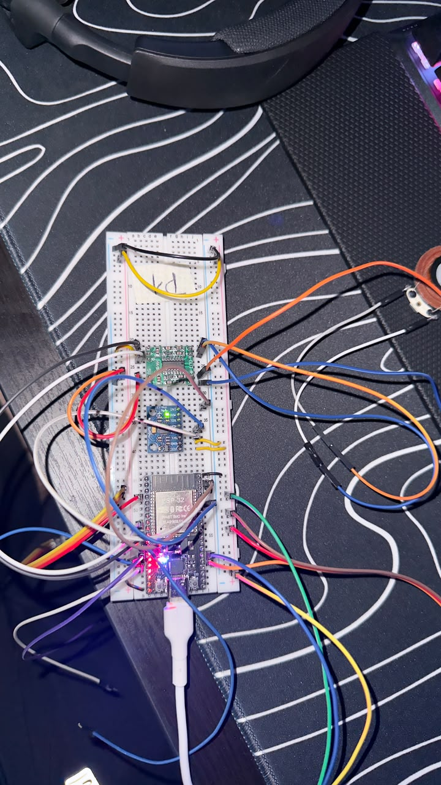
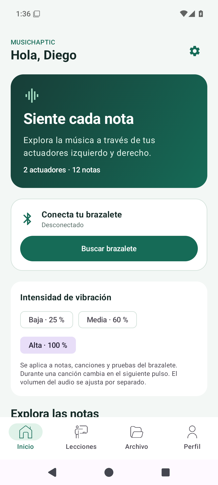
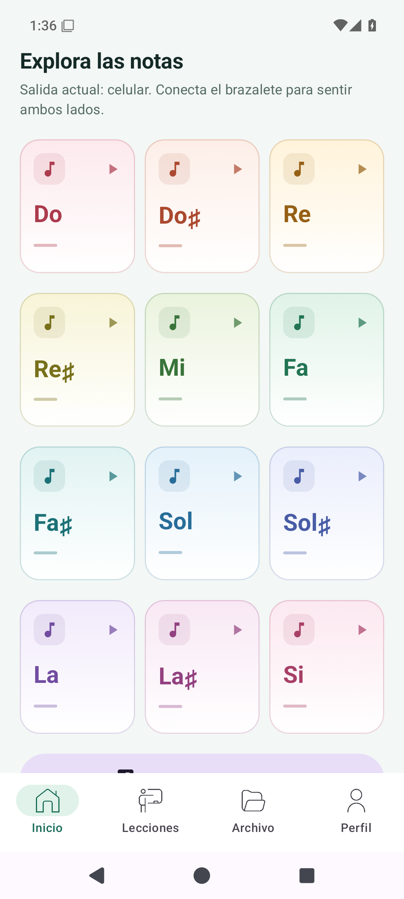
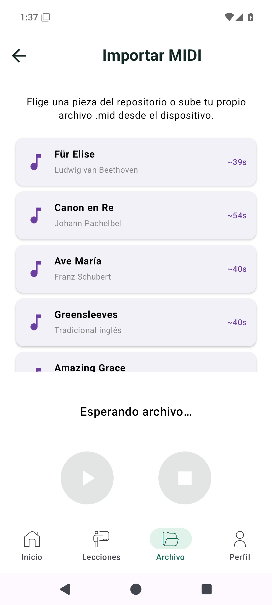
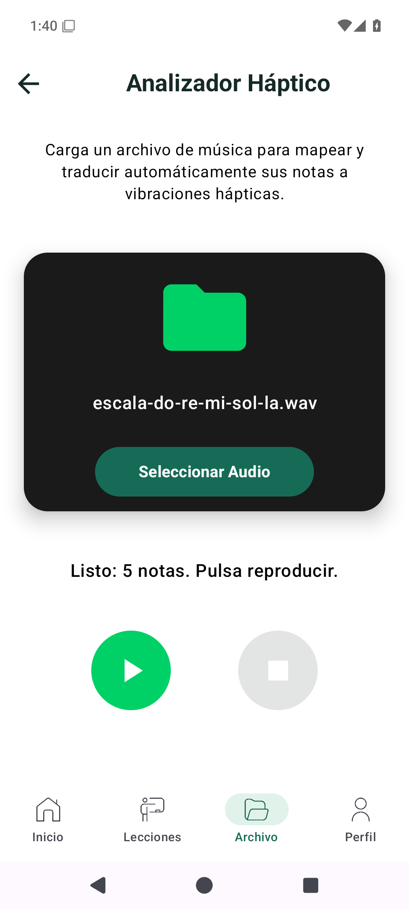
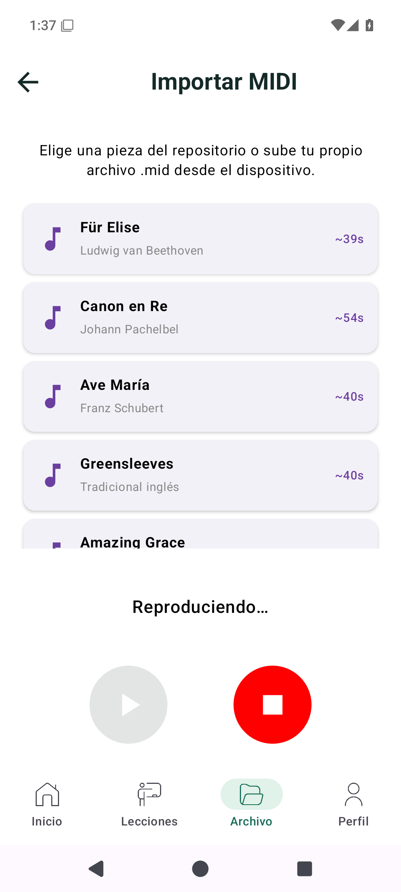
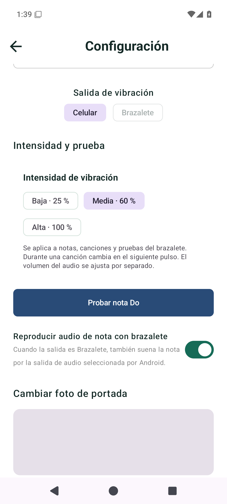

# Evidencias del prototipo

## Montaje físico

La fotografía muestra el montaje con ESP32, protoboard y módulos de control. Las entradas de señal del montaje dual corresponden a GPIO27 y GPIO16; el cableado y los parámetros se describen en la [guía del firmware](../firmware/LEEME_PRIMERO.md).

  

El [informe del proyecto](informe-sintiendo-la-musica.pdf) incluye el contexto académico, las etapas de integración y el registro fotográfico. También se conserva una [fotografía del montaje inicial](images/montaje-inicial.jpeg).

## Aplicación Android

Capturas directas de MusicHaptic **2.5.0**, tomadas el **14 de noviembre de 2026** durante su ejecución en un emulador **Android 15 / API 35**, a **1080 × 2400 píxeles**. El recorrido utiliza una cuenta local de demostración y la salida **Celular**. El brazalete permanece desconectado durante esta sesión.

<table>
  <tr><th>Inicio</th><th>Doce notas</th><th>Catálogo MIDI</th></tr>
  <tr>
    <td></td>
    <td></td>
    <td></td>
  </tr>
  <tr><th>Análisis de audio</th><th>Reproducción MIDI</th><th>Configuración</th></tr>
  <tr>
    <td></td>
    <td></td>
    <td></td>
  </tr>
</table>

## Recorrido comprobado

| Paso | Resultado observado | Evidencia |
|---|---|---|
| Crear una cuenta e iniciar sesión | Acceso al inicio y saludo del perfil local | [Inicio](images/app/inicio.png) |
| Explorar las notas | Se muestran las doce clases de nota | [Notas](images/app/notas.png) |
| Abrir una pieza de la biblioteca | Escala Mixta preparada con 24 notas; reproducción y parada disponibles | [Biblioteca](images/app/biblioteca.png), [reproducción](images/app/reproduccion.png) |
| Cargar Für Elise del catálogo MIDI | Secuencia preparada con 74 notas | [MIDI preparado](images/app/midi-preparado.png) |
| Reproducir y detener MIDI | Estado «Reproduciendo…» y botón de parada activo; retorno al estado detenido | [Reproducción MIDI](images/app/reproduccion-midi.png) |
| Importar un WAV | El analizador informa cinco notas y habilita la reproducción | [Análisis de audio](images/app/analisis-audio.png) |
| Reproducir la secuencia del WAV | Estado de reproducción activo | [Reproducción de audio](images/app/reproduccion-audio.png) |
| Abrir el desafío musical | Reproducción de una nota y opciones de respuesta disponibles | [Desafío musical](images/app/desafio-musical.png) |
| Cambiar la intensidad y probar DO | Selección Media (60 %) y ejecución del control de prueba | [Configuración](images/app/configuracion.png) |

El recorrido se completó sin cierres de la aplicación. Las capturas conservan los estados de interfaz obtenidos durante la ejecución.

## Audio de demostración

El archivo [escala-do-re-mi-sol-la.wav](samples/escala-do-re-mi-sol-la.wav) permite repetir la prueba del analizador: contiene cinco tonos monofónicos de referencia, separados por silencios. Sus parámetros están en [la descripción de la muestra](samples/README.md).

Para repetirla, descarga el WAV en el dispositivo, abre **Archivo → Subir Audio Propio → Seleccionar Audio** y selecciona la muestra. En esta sesión, la aplicación informó **«Listo: 5 notas. Pulsa reproducir.»**

## Alcance de las evidencias

Las fotografías documentan el montaje y las capturas muestran el funcionamiento de la aplicación. La sesión en emulador comprueba navegación, carga de secuencias, análisis de audio y controles de reproducción. La actuación física por BLE, la aceleración de los módulos y la percepción de las vibraciones requieren pruebas con el brazalete real.

Los resultados de compilación y de las pruebas automatizadas se encuentran en [Validación técnica](VALIDACION.md) y en [GitHub Actions](https://github.com/dsgsix/musichaptic-esp32/actions/workflows/verify.yml).
